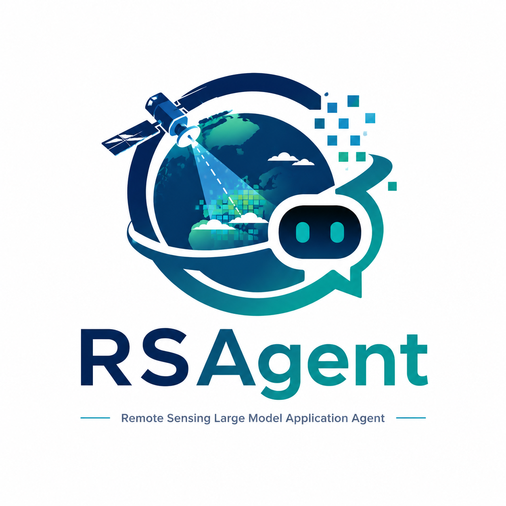
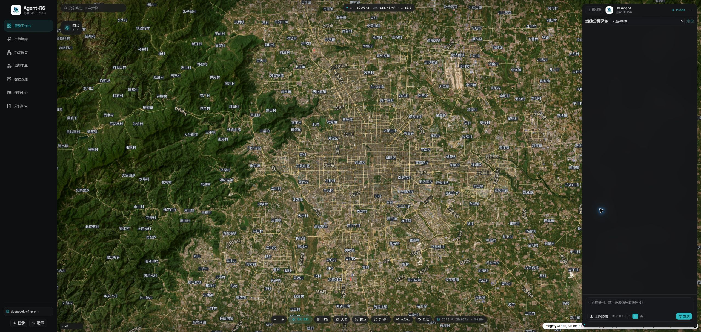
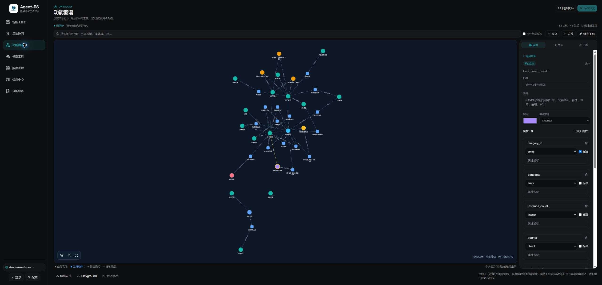
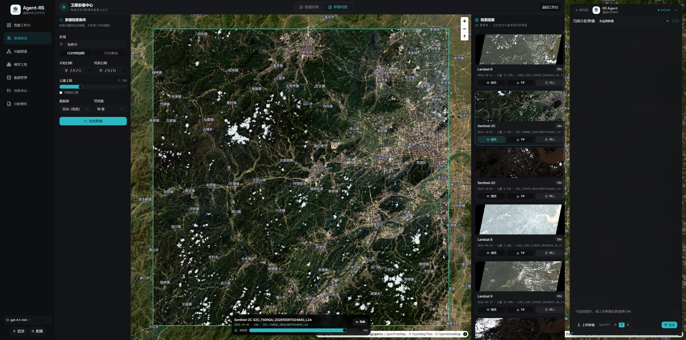
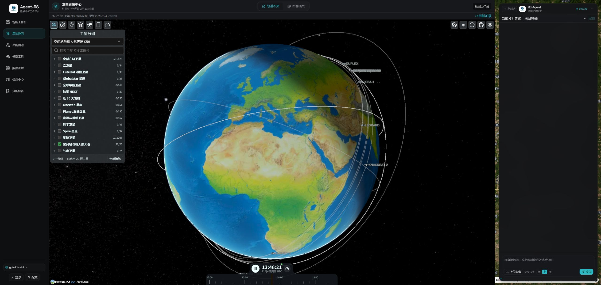

<div align="center">



# Agent-RS

**遥感智能分析与卫星态势平台**

</div>

## 本次更新（2026-11-18）

- 管理员可通过 MCP 接入、刷新和停用外部工具。启用的工具会进入对话候选集与功能图谱，调用沿用平台的资源权限和回合配额。
- 栅格分析可按次启动 Docker 算子，也可连接常驻的 Docker MCP 服务。对话会分别显示各个算子的执行进度。
- 可在 AutoGen 和 LangGraph 之间切换编排引擎，两者共用已启用的工具、权限和配额。
- OCR 长文本在对话中显示摘要，并提供完整识别结果的下载入口。
- 地图选区下载遇到临时故障时会有限重试，同一用户重复提交同一区域可复用已获取的影像。

## 平台介绍

Agent-RS 将卫星影像、地图分析、轨道态势、知识库和智能对话集中到一个平台。用户可以通过自然语言完成影像检索、目标提取、结果查看和报告生成。

### 主要功能

| 模块 | 功能 |
| --- | --- |
| 智能工作台 | 自然语言任务、地名定位、地图框选、图层管理和成果下载 |
| 功能图谱 | 实体、属性、关系与工具绑定；个人定义编辑、代码同步、规划条件约束和可视化导出 |
| 卫星影像 | 按区域、时间和云量检索 Sentinel-2、Landsat 等公开影像，预览、下载和导入 |
| 轨道态势 | 卫星查询、三维地球、轨道展示、卫星图标及中英文切换 |
| 地物分类与提取 | 使用 SAM3 按自然语言概念分割建筑、道路、水体等目标，输出实例轮廓、目标框、置信度和统计 |
| 目标检测 | 识别船舶、车辆、飞机等目标，输出类别、旋转框、置信度及数量统计 |
| 遥感工具 | 通过 MCP 调用 Docker 算子，支持影像质检、光谱指数、水体与云阴影掩膜、文字识别、波段合成、裁剪和重投影 |
| 知识中心 | 文档管理、相关内容检索和知识图谱关联展示 |
| 报告中心 | 汇总已完成分析，导出包含预览图、成果清单和适用说明的 Word 报告 |

### 平台界面

#### 智能工作台

通过左侧导航切换功能，在地图中查看影像、框选区域和管理结果图层。右侧对话面板提供自然语言任务与影像上传入口，可调整大小或收起；工作台不再叠加独立的欢迎悬浮窗。



#### 功能图谱

在独立页面浏览地物分类、目标检测等能力与数据对象之间的关系。圆形节点表示实体，方形节点表示工具动作，箭头表示数据流转；右侧编辑器用于维护属性、关系和工具条件。

支持个人定义保存、代码同步和 JSON 导出。规划时根据已有数据条件提供可用工具，区分条件满足、待核验和不满足的情况。此处管理平台的业务与工具定义，与知识库从文档中提取的知识图谱分别使用。



#### 卫星影像中心

从左侧「星地协同」进入「影像档案」，按区域、日期和云量检索公开卫星影像，在目录地图上预览覆盖范围与影像，并按需下载或导入。右侧保留当前对话，检索不会改变工作台视角。



#### 卫星轨道态势

在「星地协同」的「轨道态势」中，通过三维地球查看卫星位置和轨道，按名称、编号或分组选择卫星。左侧主导航与右侧对话沿用工作台布局。



### 遥感分析流程


[查看 SVG 流程图](docs/diagrams/agent-rs-analysis-workflow.svg)

1. 上传本地 GeoTIFF、检索并导入公开卫星影像，或直接框选地图区域。
2. 确认分析影像和范围；地图框选也可用于检索覆盖该区域的影像。
3. 可选：进入「功能图谱」了解已有能力与数据条件，按需编辑并保存个人定义，供后续新规划使用。
4. 在右侧对话中用自然语言提出任务，例如“提取框选区域内的建筑和道路”，查看执行进度；遇到问题时按提示补充数据或调整参数后重新提交。
5. 在地图查看叠加结果，下载实际生成的 GeoTIFF、GeoJSON 或预览图。
6. 按需生成 Word 报告，汇总实际完成的分析与成果。

分析能力取决于影像分辨率、波段和模型适用范围。轨道态势用于展示卫星位置，不代表对应位置一定有可下载影像。

## 快速启动

环境要求：Python 3.11+、Node.js 18+、uv、PostgreSQL 和 Docker。以下命令使用 Bash。

复制配置模板：

```bash
cp backend/.env.example backend/.env
```

按模板填写数据库、登录密钥和聊天模型配置。使用 Compose 时，还需在私有根 `.env` 中设置数据库及对象存储口令，并与后端配置保持一致，见[配置说明](docs/deployment-security.md)。

安装依赖并启动：

```bash
uv sync --project backend
npm --prefix Agent-frontend ci
npm run dev
```

启动后访问 <http://localhost:5173>。SAM3 等分析能力需要配置对应模型和计算服务，见下方使用说明。

构建包含卫星轨道展示资源的完整前端时，使用项目的构建脚本：

```bash
SATVIS_WORKDIR="$PWD/.tmp_satvis" bash ops/build_release_frontend.sh
```

已有环境升级时，需要同步前后端并重新构建前端。个人图谱保存依赖数据库及新增的定义表，后端初始化数据库连接时会通过现有迁移流程创建；配置项与升级说明见[功能图谱指南](docs/ontology-guide.md#升级与配置)。

## 使用说明

- [Docker 算子与 MCP 接入指南](docs/mcp.md)
- [功能图谱与本体定义指南](docs/ontology-guide.md)
- [知识库使用指南](docs/knowledge-guide.md)
- [地图地名与底图说明](docs/map-labels.md)
- [SAM3 分割配置](docs/segmentation-deployment.md)
- [目标检测配置](docs/detection-deployment.md)
- [第三方组件与许可证](THIRD_PARTY_NOTICES.md)

## 许可

本项目采用限制性源码可见许可，仅允许个人、非商业、本地学习与评估。商业使用、对外提供服务、二次分发及学术发表等用途须事先取得书面许可，完整条款见 [LICENSE](LICENSE)。第三方依赖分别受其原始许可证约束。
