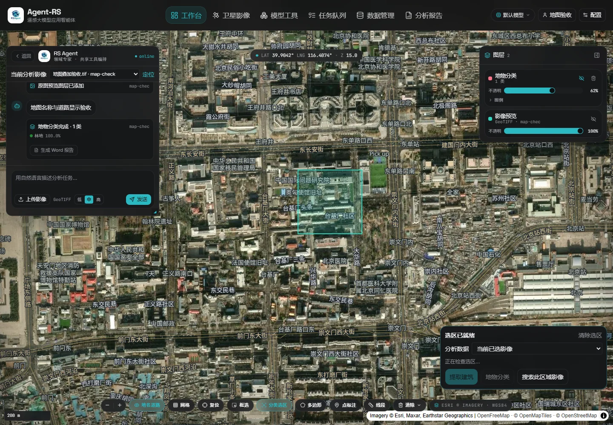
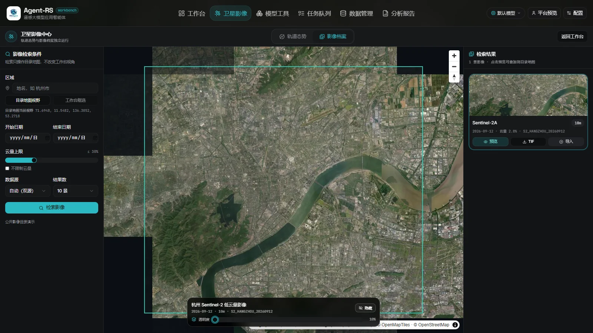
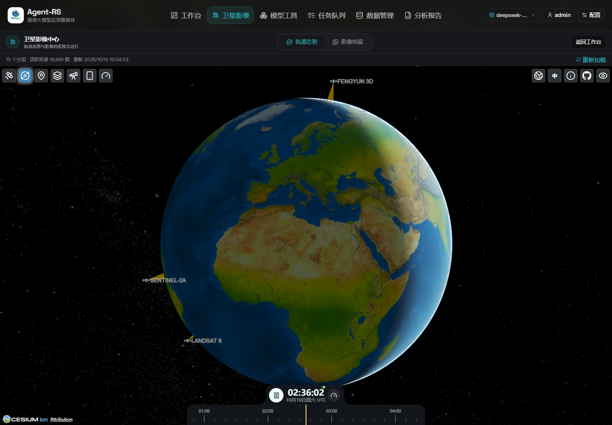
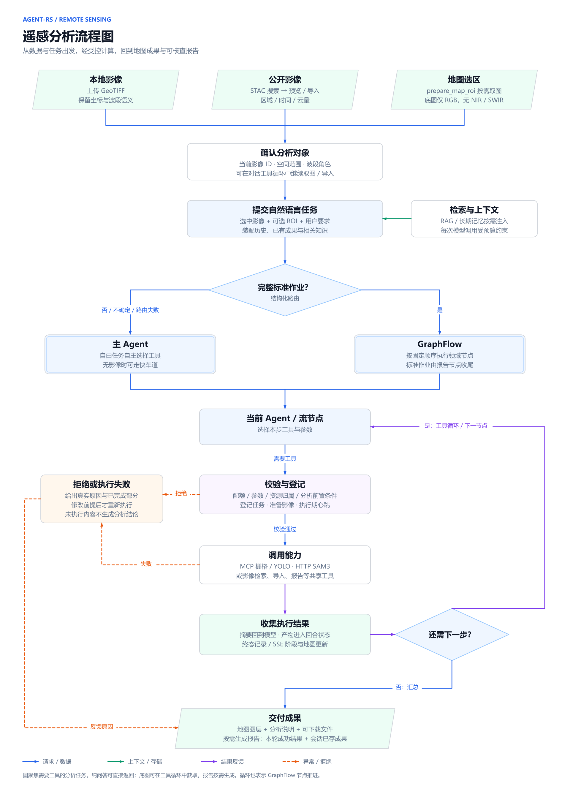

<div align="center">


# Agent-RS

**遥感智能分析与卫星态势平台**

</div>

## 本次更新（2026-10-10）

- 恢复卫星目录查询，支持按名称、编号和分组选择卫星，查看位置与轨道。
- 增加目录更新时间和重新加载功能；数据源异常时保留有效目录并提供备用数据，补齐星空纹理。
- 修正影像波段匹配、无效像素处理、光谱指数定标，以及水体和云阴影统计。
- 修复流式对话的上下文丢失，完善长任务连接、中断处理和历史恢复。
- 完善分析结果叠加、成果保存和报告下载，报告包含实际分析结果与预览图。
- 加强账号间的数据隔离，完善登录、会话失效提示和管理员权限。
- 优化文档解析与影像预处理的资源控制，修复 Excel 解析和 OCR 运行问题。
- 改进配置加载失败、超长消息和请求被拒绝后的恢复，完善 SAM3 官方推理兼容性与启动检查。

## 平台介绍

Agent-RS 将卫星影像、地图分析、轨道态势、知识库和智能对话集中到一个平台。用户可以通过自然语言完成影像检索、目标提取、结果查看和报告生成。

### 主要功能

| 模块 | 功能 |
| --- | --- |
| 智能工作台 | 自然语言任务、地名定位、地图框选、图层管理和成果下载 |
| 卫星影像 | 按区域、时间和云量检索 Sentinel-2、Landsat 等公开影像，预览、下载和导入 |
| 轨道态势 | 卫星查询、三维地球、轨道展示、卫星图标及中英文切换 |
| SAM3 目标提取 | 按自然语言概念分割多个目标，输出实例轮廓、目标框、置信度和统计 |
| 遥感工具 | 影像质检、光谱指数、水体与云阴影掩膜、目标检测、裁剪和重投影 |
| 知识中心 | 文档管理、相关内容检索和知识图谱关联展示 |
| 报告中心 | 汇总已完成分析，导出包含预览图、成果清单和适用说明的 Word 报告 |

### 平台界面

#### 智能工作台

在地图中查看影像、框选区域、发起分析和管理结果图层。对话框与图层面板支持调整大小。



#### 卫星影像中心

在独立页面完成影像检索、预览、下载、导入和档案管理。



#### 卫星轨道态势

通过三维地球查看卫星位置和轨道，按名称、编号或分组选择卫星。



### 遥感分析流程



[查看 SVG 流程图](docs/diagrams/agent-rs-analysis-workflow.svg)

1. 上传本地 GeoTIFF、检索并导入公开卫星影像，或直接框选地图区域。
2. 确认分析影像和范围；地图框选也可用于检索覆盖该区域的影像。
3. 用自然语言提出任务，例如“提取框选区域内的建筑和道路”。
4. 在地图查看叠加结果，下载 GeoTIFF、GeoJSON 或预览图。
5. 按需生成 Word 报告，汇总实际完成的分析与成果。

分析能力取决于影像分辨率、波段和模型适用范围。轨道态势用于展示卫星位置，不代表对应位置一定有可下载影像。

## 快速启动

环境要求：Python 3.11+、Node.js 18+、uv、PostgreSQL 和 Docker。以下命令使用 Bash。

复制配置模板：

```bash
cp backend/.env.example backend/.env
```

按模板填写数据库、登录密钥和聊天模型配置。使用 Compose 时，还需在私有根 `.env` 中设置数据库及对象存储口令，并与后端配置保持一致，见[配置说明](docs/deployment-security.md)。

安装依赖并启动：

```bash
uv sync --project backend
npm --prefix Agent-frontend ci
npm run dev
```

启动后访问 <http://localhost:5173>。SAM3 等分析能力需要配置对应模型和计算服务，见下方使用说明。

## 使用说明

- [知识库使用指南](docs/knowledge-guide.md)
- [地图地名与底图说明](docs/map-labels.md)
- [SAM3 分割配置](docs/segmentation-deployment.md)
- [第三方组件与许可证](THIRD_PARTY_NOTICES.md)

## 许可

本项目采用限制性源码可见许可，仅允许个人、非商业、本地学习与评估。商业使用、对外提供服务、二次分发及学术发表等用途须事先取得书面许可，完整条款见 [LICENSE](LICENSE)。第三方依赖分别受其原始许可证约束。
