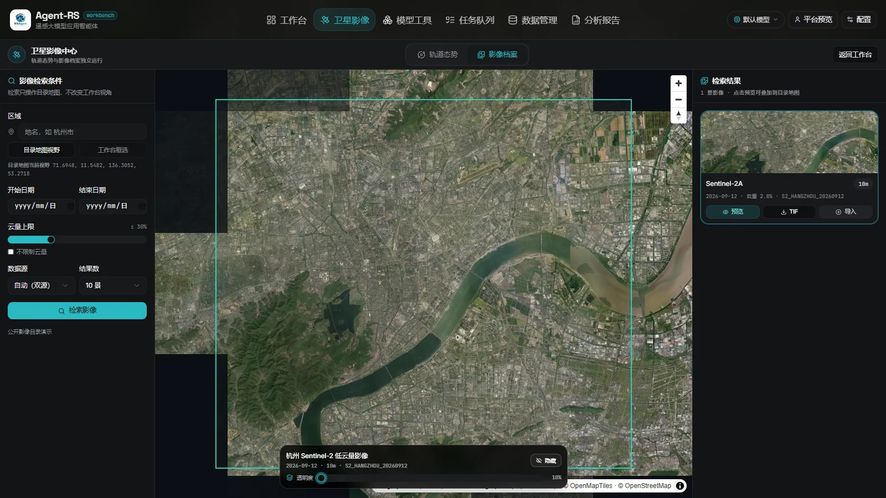
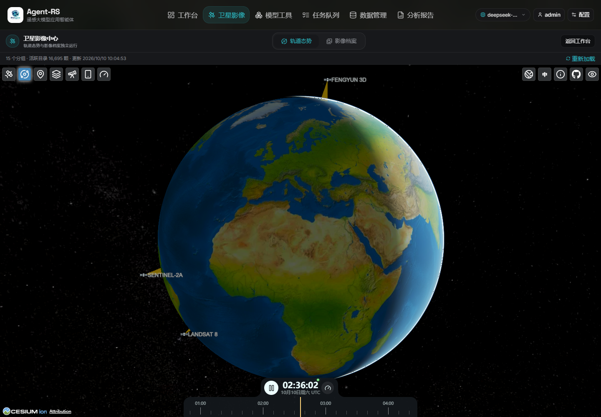
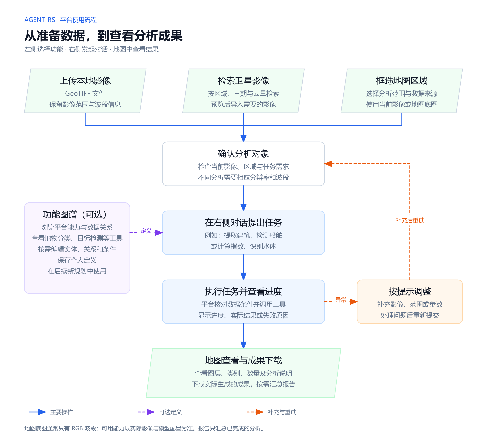

<div align="center">


# Agent-RS

**遥感智能分析与卫星态势平台**

</div>

## 本次更新（2026-11-04）

本次大更新围绕 **工作台界面、可编辑功能图谱和遥感任务稳定性** 展开：统一平台入口，让数据、工具和分析结果之间的关系可见、可编辑，并为任务规划补充实际数据条件的约束。

### 工作台 UI 与交互

- **主导航移至左侧**：智能工作台、星地协同、功能图谱、模型工具、数据管理、任务中心和分析报告集中展示；模型选择、账号和配置入口收纳到底部。窄屏切换为图标导航。
- **对话统一放在右侧**：移除原先独立的欢迎悬浮窗，进入工作台即可开始对话或上传影像。对话面板支持收起、展开、新建对话及宽高调整，切换工作台与星地协同时保留当前对话。
- **调整地图操作布局**：图层入口及图层面板移到地图左侧，选区操作与新的导航布局协调；对话面板从左边缘调整宽度，减少遮挡地图的操作区域。

### 独立功能图谱与自定义编辑

- **新增「功能图谱」页面**：用实体、关系和工具动作展示平台基础能力，支持搜索、拖动、缩放、适应画布，以及点击查看属性、输入输出和工具绑定。
- **补齐遥感能力展示**：将地物分类与提取、目标检测、影像质检、光谱指数、水体与云阴影提取、影像裁剪、文档解析和报告生成等现有能力纳入图谱，展示从输入数据到分析成果的路径。地物分类与提取对应现有 SAM3 概念分割能力。
- **开放个人定义**：可以新增或调整实体及属性、实体关系、工具绑定、前置条件和输出实体。个人定义按账号保存；基础定义保留，个人新增项支持删除。
- **支持代码识别与同步**：从工具注册表、指定目录中的工具声明和数据模型、固定作业流程中识别定义；新工具完成注册并重新加载后端后可加入图谱。源码已发现但尚未注册的工具单独标为待接入。
- **保护编辑内容**：页面定期同步代码，有未保存草稿时暂停自动同步；主动同步保留草稿，遇到冲突明确提示。切换页面保留草稿，刷新或关闭前提醒保存。
- **支持配置导出**：可导出完整本体定义，以及用于可视化展示的实体与关系 JSON，便于汇报和后续扩展。操作与接入范围见[功能图谱使用指南](docs/ontology-guide.md)。

### 任务规划与影像稳定性

- **规划参考真实数据状态**：根据当前账号可访问的影像、选区、场景、文档及已完成结果，区分条件满足、待核验和不满足的下游工具；调用前再次检查已知条件，减少工具选择与数据条件不匹配的问题。
- **保留现有工具执行与校验**：个人图谱编辑不能绕过原有权限、参数和必要波段条件；不同影像的状态分别判断，失败结果不会被当成已完成的分析成果。
- **修复影像预览反复失败**：远程影像读取不完整时，清理对应资产的异常缓存并有限重读；最终失败也清理残留，避免后续请求持续命中坏缓存。预览、下载与导入共用读取恢复机制。
- **协调等待与取消行为**：延长预览等待时间，避免后台恢复成功前页面提前报超时；取消后不再追加重试，未完成的预览不会作为成功成果发布。

## 平台介绍

Agent-RS 将卫星影像、地图分析、轨道态势、知识库和智能对话集中到一个平台。用户可以通过自然语言完成影像检索、目标提取、结果查看和报告生成。

### 主要功能

| 模块 | 功能 |
| --- | --- |
| 智能工作台 | 自然语言任务、地名定位、地图框选、图层管理和成果下载 |
| 功能图谱 | 实体、属性、关系与工具绑定；个人定义编辑、代码同步、规划条件约束和可视化导出 |
| 卫星影像 | 按区域、时间和云量检索 Sentinel-2、Landsat 等公开影像，预览、下载和导入 |
| 轨道态势 | 卫星查询、三维地球、轨道展示、卫星图标及中英文切换 |
| 地物分类与提取 | 使用 SAM3 按自然语言概念分割建筑、道路、水体等目标，输出实例轮廓、目标框、置信度和统计 |
| 目标检测 | 识别船舶、车辆、飞机等目标，输出类别、旋转框、置信度及数量统计 |
| 遥感工具 | 影像质检、光谱指数、水体与云阴影掩膜、文字识别、波段合成、裁剪和重投影 |
| 知识中心 | 文档管理、相关内容检索和知识图谱关联展示 |
| 报告中心 | 汇总已完成分析，导出包含预览图、成果清单和适用说明的 Word 报告 |

### 平台界面

#### 智能工作台

通过左侧导航切换功能，在地图中查看影像、框选区域和管理结果图层。右侧对话面板提供自然语言任务与影像上传入口，可调整大小或收起；工作台不再叠加独立的欢迎悬浮窗。


#### 功能图谱

在独立页面浏览地物分类、目标检测等能力与数据对象之间的关系。圆形节点表示实体，方形节点表示工具动作，箭头表示数据流转；右侧编辑器用于维护属性、关系和工具条件。

支持个人定义保存、代码同步和 JSON 导出。规划时根据已有数据条件提供可用工具，区分条件满足、待核验和不满足的情况。此处管理平台的业务与工具定义，与知识库从文档中提取的知识图谱分别使用。


#### 卫星影像中心

在独立页面完成影像检索、预览、下载、导入和档案管理。



#### 卫星轨道态势

通过三维地球查看卫星位置和轨道，按名称、编号或分组选择卫星。



### 遥感分析流程



[查看 SVG 流程图](docs/diagrams/agent-rs-analysis-workflow.svg)

1. 上传本地 GeoTIFF、检索并导入公开卫星影像，或直接框选地图区域。
2. 确认分析影像和范围；地图框选也可用于检索覆盖该区域的影像。
3. 用自然语言提出任务，例如“提取框选区域内的建筑和道路”。
4. 在地图查看叠加结果，下载 GeoTIFF、GeoJSON 或预览图。
5. 按需生成 Word 报告，汇总实际完成的分析与成果。

分析能力取决于影像分辨率、波段和模型适用范围。轨道态势用于展示卫星位置，不代表对应位置一定有可下载影像。

## 快速启动

环境要求：Python 3.11+、Node.js 18+、uv、PostgreSQL 和 Docker。以下命令使用 Bash。

复制配置模板：

```bash
cp backend/.env.example backend/.env
```

按模板填写数据库、登录密钥和聊天模型配置。使用 Compose 时，还需在私有根 `.env` 中设置数据库及对象存储口令，并与后端配置保持一致，见[配置说明](docs/deployment-security.md)。

安装依赖并启动：

```bash
uv sync --project backend
npm --prefix Agent-frontend ci
npm run dev
```

启动后访问 <http://localhost:5173>。SAM3 等分析能力需要配置对应模型和计算服务，见下方使用说明。

构建包含卫星轨道展示资源的完整前端时，使用项目的构建脚本：

```bash
SATVIS_WORKDIR="$PWD/.tmp_satvis" bash ops/build_release_frontend.sh
```

已有环境升级时，需要同步前后端并重新构建前端。个人图谱保存依赖数据库及新增的定义表，后端初始化数据库连接时会通过现有迁移流程创建；配置项与升级说明见[功能图谱指南](docs/ontology-guide.md#升级与配置)。

## 使用说明

- [功能图谱与本体定义指南](docs/ontology-guide.md)
- [知识库使用指南](docs/knowledge-guide.md)
- [地图地名与底图说明](docs/map-labels.md)
- [SAM3 分割配置](docs/segmentation-deployment.md)
- [目标检测配置](docs/detection-deployment.md)
- [第三方组件与许可证](THIRD_PARTY_NOTICES.md)

## 许可

本项目采用限制性源码可见许可，仅允许个人、非商业、本地学习与评估。商业使用、对外提供服务、二次分发及学术发表等用途须事先取得书面许可，完整条款见 [LICENSE](LICENSE)。第三方依赖分别受其原始许可证约束。
