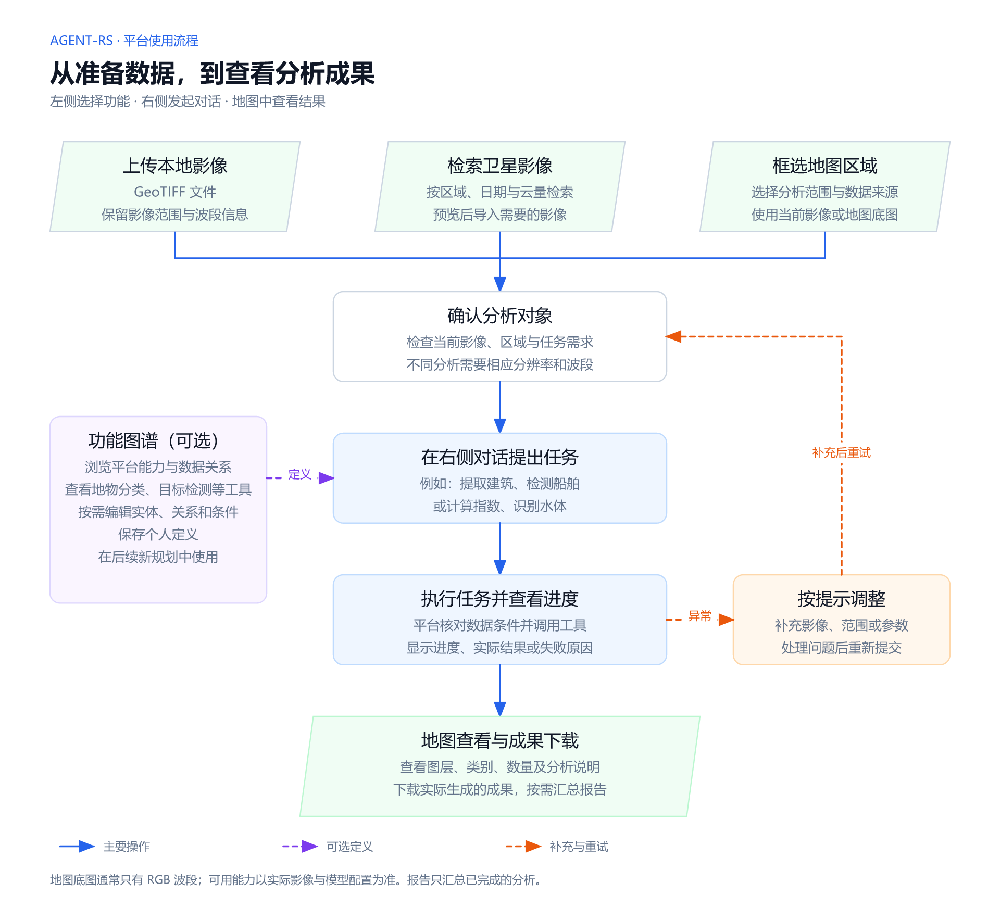

# 遥感分析流程图

展示当前平台从影像准备、确认分析对象，到右侧对话提交任务、查看进度和下载成果的使用流程。左侧主导航负责切换功能，对话与地图结果分别在右侧和主区域展示。

[查看 SVG 矢量图](agent-rs-analysis-workflow.svg)

支持本地影像、公开卫星影像和地图框选三种入口。框选区域可结合当前影像或地图底图用于分析，也可用于检索覆盖该区域的卫星影像；地图底图通常只有 RGB 波段，可用能力以实际数据和模型配置为准。

「功能图谱」是可选入口，用于浏览地物分类、目标检测等工具及其数据关系，按需编辑实体、关系和条件。保存的个人定义供后续新规划使用。

执行前核对数据条件；失败时展示原因，补充数据或调整参数后重新提交。只下载实际生成的成果，报告仅汇总已完成的分析。
