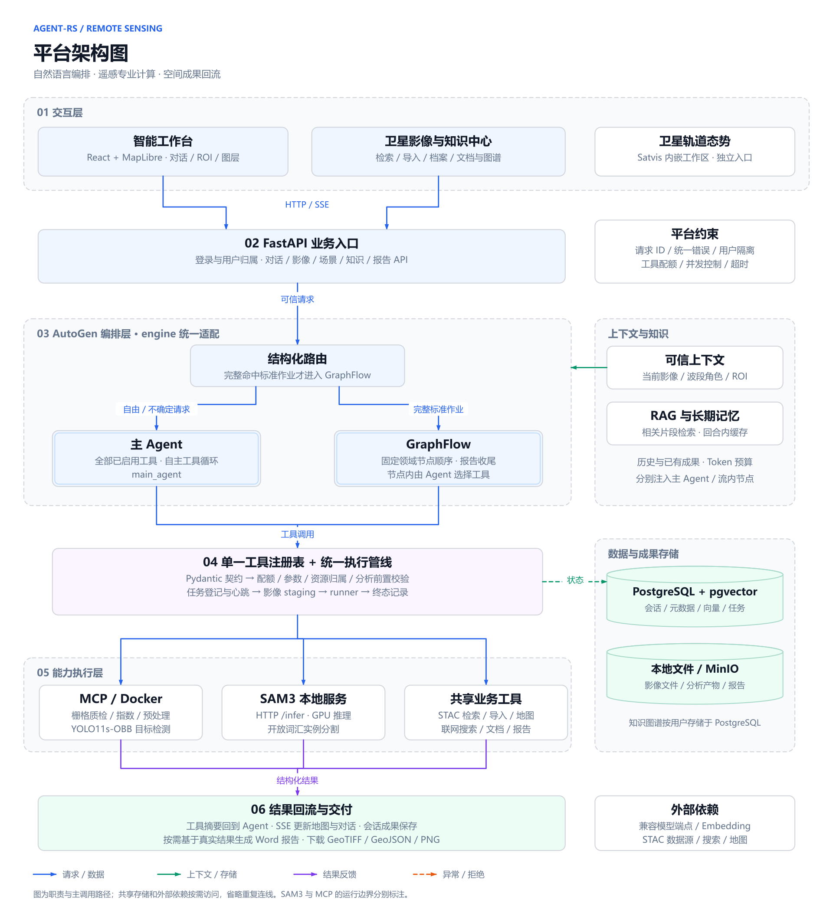

# Agent-RS 平台架构与分析流程

核对基线：[`5e284b0`](https://github.com/lryoooow/Agent-RS/commit/5e284b0)，文档更新于 2026-09-21。本文描述仓库中的现行实现，图中的分层表示职责，不表示每一层都部署为独立服务。

## 平台架构



[SVG 矢量版](diagrams/agent-rs-platform-architecture.svg)

平台把交互、业务入口、Agent 编排、工具执行、计算运行时和成果交付分开。主链路是：用户指定任务与影像 → 服务端装配可信上下文 → 选择主 Agent 或 GraphFlow → 统一校验并调用专业工具 → 结构化结果回到对话、地图、历史和报告。

### 双路径编排

- **主 Agent**：自由问答、单步分析和未完整命中预设的多步请求，由 `main_agent` 持有已启用工具并进行工具循环。
- **GraphFlow**：只有当前请求明确要求预设的全部步骤、顺序成立且没有额外跨领域步骤，才采用固定流程。固定的是节点顺序，节点内部的工具选择仍由模型完成。
- **回退与快车道**：路由失败或不确定时使用主 Agent。自动流程关闭时直接使用主 Agent；开启快车道且用户无影像时，也可跳过路由模型。

预设名称仍为 `inspect_index_report`、`mask_segment_report`、`detect_report`。其中 `mask_segment_report` 的路由文案保留“地物分类”旧称，当前分割工具已经是 `segment_instances` / SAM3。流程节点的可用性仍取决于已启用工具、影像条件和模型调用结果，固定流程不保证每一步成功。

### 统一工具契约与执行

工具注册表声明名称、Pydantic 参数模型、runner、资源类型、作用域与可用条件。对模型公开的参数定义由参数模型生成。工具包装器处理本轮配额、可信影像与 ROI 参数绑定，再进入统一管线：

```text
可用性 → 参数校验 → 资源归属 → 分析前置条件
      → 任务登记 / 心跳 → 影像 staging → runner → 终态记录
```

每次调用独立校验。用户身份来自服务端请求上下文，不由模型参数指定。SAM3 分割额外检查 ROI 与影像相交关系，以及可判定分辨率是否符合平台上限；工具 runner 继续检查波段和输入文件。配额、并发限制与超时分别约束调用次数、同时运行数量和执行时长。

任务记录为 best-effort；关闭数据库或登记失败时不能把它描述成可靠的分布式任务队列。上下文和任务控制可约束执行，但不构成影像质量、识别精度或高可用承诺。

### 遥感计算与数据服务

| 能力 | 实际调用边界 | 主要产物或用途 |
| --- | --- | --- |
| 栅格算子 | runner → stdio MCP → Docker | 质检、光谱指数、波段合成、掩膜、裁剪与重投影 |
| YOLO11s-OBB | 检测 runner → MCP / Docker | 遥感目标检测、旋转框与地图成果 |
| SAM3 | 分割 runner → 本地 HTTP `/infer` 服务 | 开放词汇实例分割；平台恢复空间位置并生成栅格、矢量与统计文件 |
| 公开影像 | STAC 适配层 → EarthSearch / Planetary Computer | Sentinel-2 / Landsat 检索、预览、下载与导入 |
| 地图框选取图 | `prepare_map_roi` → 地图影像服务 | 选区 RGB 影像；原始分辨率与日期未知，不提供 NIR / SWIR |
| 知识与文档 | 文档解析、Embedding、RAG 与 PostgreSQL 图存储 | 相关片段、长期记忆，以及文档 / 片段 / 工具 / Agent 的关系展示 |
| 报告 | `generate_report` → 会话成果与本轮成功结果 → 报告构建器 | Word 报告、分析依据、成果清单、完成情况与适用边界 |

当前 SAM3 与 YOLO 的目标识别在部署服务器本地运行；聊天模型、Embedding、影像目录、搜索和地图仍可能调用外部服务。卫星轨道态势是嵌入 Satvis 的独立前端工作区，图中没有把它画成经过 Agent 的影像处理步骤。

### 上下文与结果各走各的通道

上下文包括历史、已核验的当前影像、波段角色、地图选区和已有成果。RAG 与长期记忆通过 AutoGen Memory 适配，在模型调用前按需检索；同一回合的重复检索可以命中缓存。知识图谱用于展示和关联文档、片段、工具与 Agent，不代表自动生成新工具或自动训练模型。

工具返回 `ToolRunResult`：`tool_context` 是供模型消费的摘要，地图图层、文件和执行元数据由回合状态收集。服务层通过事件桥输出 SSE，最终保存会话结果。报告工具读取当前回合已经成功的分析和对话中已存的成果，因此在助手最终消息落库之前也能引用本轮分析。

PostgreSQL / pgvector 保存会话、资源元数据、向量与任务记录；知识图谱也使用 PostgreSQL。文件存储支持本地目录与 MinIO，影像在需要时 staging 到工具可读取的位置；具体成果文件的保存路径由各 runner 和报告构建器管理。

## 分析流程


[SVG 矢量版](diagrams/agent-rs-analysis-workflow.svg)

1. **提供数据或区域。** 上传影像、检索公开场景，或提出地图框选分析。取图与导入也可发生在对话工具循环中。
2. **明确任务对象。** 将当前影像、选区和自然语言要求送入请求；服务端核验归属，装配影像语义、历史和相关资料。
3. **选择执行路径。** 完整预设走 GraphFlow，自由或不确定任务走主 Agent。图聚焦需要工具的遥感分析，纯问答不必经过计算节点。
4. **按步校验和计算。** 每次调用检查参数、资源与前置条件，执行对应 runner，记录结果和状态。
5. **反馈并继续。** 成功结果的摘要返回 Agent，空间成果和文件进入回合状态；若还需工具或后续流程节点，继续在同一路径推进。
6. **交付与解释。** 对话说明、地图叠加和下载链接共同呈现成果。需要报告时调用报告工具，并区分已经完成、失败和未执行的分析。

流程图将拒绝和不可继续的失败合并为异常分支。可修正的参数错误可以由 Agent 在调用预算内修正；资源越权、服务故障或影像条件不满足时，应说明原因或先改变前提。异常路径不表示生成了成功的遥感成果。

## 设计优势的依据

这套架构适合遥感平台的原因在于三个明确的衔接：**任务与真实影像衔接、智能决策与专业计算衔接、计算成果与空间交付衔接**。双路径编排兼顾探索与标准作业；统一契约和执行管线使新增算法有明确入口；结果摘要与空间产物分离，使模型解释与地图展示能够使用同一次工具执行的证据。

这些是由实现结构得出的设计判断。本文没有进行架构对比实验，也不据此宣称精度、延迟或成本优于其他平台。

## 源码对应

| 图中模块 / 机制 | 源码 |
| --- | --- |
| 工作台、当前影像与地图交互 | [App.tsx](../Agent-frontend/src/app/App.tsx)、[MapView.tsx](../Agent-frontend/src/app/components/MapView.tsx) |
| 影像中心与独立轨道入口 | [SatelliteWorkspace.tsx](../Agent-frontend/src/app/components/SatelliteWorkspace.tsx) |
| HTTP 与 SSE 入口 | [API routes](../backend/app/api/routes)、[chat_service.py](../backend/app/services/chat_service.py) |
| 可信上下文、影像与 ROI | [input.py](../backend/app/agent/engine/input.py)、[raster_semantics.py](../backend/app/services/raster_semantics.py) |
| 路由、主 Agent 与 GraphFlow | [router.py](../backend/app/agent/engine/router.py)、[orchestrator.py](../backend/app/agent/engine/orchestrator.py)、[flows.py](../backend/app/agent/engine/flows.py) |
| 单一工具注册与 schema | [tool_registry.py](../backend/app/agent/tool_registry.py)、[schema_gen.py](../backend/app/agent/tools/schema_gen.py) |
| 配额、参数绑定与统一校验 | [tools.py](../backend/app/agent/engine/tools.py)、[turn_context.py](../backend/app/agent/engine/turn_context.py)、[tool_execution.py](../backend/app/agent/tool_execution.py) |
| MCP 与本地 SAM3 | [rs_tools_client.py](../backend/app/mcp/rs_tools_client.py)、[检测 runner](../backend/app/agent/tools/detect/runner.py)、[分割 runner](../backend/app/agent/tools/instance_segment/runner.py)、[sam3_service.py](../ops/sam3_service.py) |
| 影像目录与地图取图 | [stac_search](../backend/app/agent/stac_search)、[map_roi.py](../backend/app/services/map_roi.py) |
| 检索、记忆与图谱 | [engine/memory](../backend/app/agent/engine/memory)、[knowledge/service.py](../backend/app/knowledge/service.py) |
| 成果反馈与报告 | [event_bridge.py](../backend/app/agent/engine/event_bridge.py)、[报告 runner](../backend/app/agent/tools/report/runner.py)、[report/builder.py](../backend/app/agent/report/builder.py) |
| 存储与任务记录 | [object_store.py](../backend/app/storage/object_store.py)、[tool_jobs.py](../backend/app/agent/tool_jobs.py)、[db/repositories](../backend/app/db/repositories) |
| 框架依赖方向约束 | [test_engine_boundary.py](../backend/tests/test_engine_boundary.py) |

图表修改与导出方法见 [图表维护说明](diagrams/README.md)。
